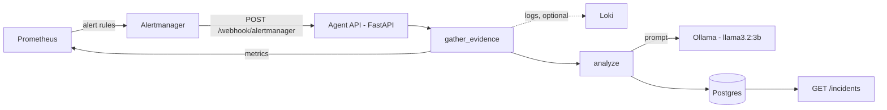

# Incident Response Agent

[](https://github.com/sahilransing2004-netizen/incident-response-agent/actions/workflows/ci.yml)

An alert-triage service for on-call engineers. Alertmanager sends a firing alert to a webhook; the agent pulls live evidence from Prometheus (and Loki, if available), asks a local LLM for a root-cause analysis and remediation steps, and stores the result so it can be read from an API.

It runs fully locally: the model is served by [Ollama](https://ollama.com), so no alert data leaves your machine.

## How it works



The analysis runs as a small [LangGraph](https://github.com/langchain-ai/langgraph) pipeline with two nodes:

1. **gather_evidence** queries Prometheus for `up`, `cpu_rate_5m` and `resident_memory_bytes` for the alert's job, and Loki for logs when it is reachable.
2. **analyze** compares the alert's CPU claim with the measured value in code. On a mismatch it writes the answer itself; otherwise it sends the alert and evidence to the model and parses a `ROOT CAUSE` and `REMEDIATION` out of the reply.

Design choices worth knowing:

- Alerts are de-duplicated by Alertmanager fingerprint, so a repeated alert is accepted once.
- Analysis runs as a background task, so the webhook returns immediately.
- Missing data is never treated as a cause. If a metric or log source is unavailable, the prompt tells the model to say the cause is undetermined instead of blaming monitoring tools.
- If the evidence contradicts the alert, the analysis must say so (see the example below).
- Webhook and incident endpoints require an `X-Webhook-Token` header.

## Services

| Service | Port | Purpose |
|---|---|---|
| agent | 8001 | FastAPI app (`/health`, `/metrics`, webhook, incidents API) |
| db | internal | Postgres 16, stores incidents |
| prometheus | 9090 | Metrics and alert rules |
| alertmanager | 9093 | Routes alerts to the agent webhook |
| grafana | 3000 | Dashboards (login: `admin` / your `GRAFANA_PASSWORD`) |

Ollama is expected on the host at `localhost:11434`; the agent container reaches it through `host.docker.internal`.

## Quick start

Requirements: Docker with Compose, and Ollama with the model pulled.

```bash
ollama pull llama3.2:3b

git clone https://github.com/sahilransing2004-netizen/incident-response-agent.git && cd incident-response-agent
cp .env.example .env        # then edit the three values
docker compose up -d --build
curl http://localhost:8001/health
```

Alertmanager reads its webhook token from `monitoring/alertmanager/webhook_token` (git-ignored, not committed). Create that file yourself; it is the shared secret between Alertmanager and the agent.

## Try it

`scripts/send_test_alert.sh` sends a fake "CPU at 90%" alert for a job and waits for the analysis. Point it at a job Prometheus actually scrapes (Prometheus scrapes itself) so there is real data to compare against:

```bash
JOB=prometheus ./scripts/send_test_alert.sh
```

Real output, with the alert claiming 90% CPU while Prometheus measures almost none:

```text
webhook response: {"accepted":[5]}
waiting for analysis of incident 5 (up to 150s)...
ROOT CAUSE: The evidence contradicts the alert: it claims 90% CPU but Prometheus measured 0.01% of one core, so the alert is likely a false positive or stale. The root cause of the original alert is undetermined from the evidence; the alert rule or a stale alert is the first thing to check.
REMEDIATION: 1. Verify the alert rule: open its expression and threshold in Prometheus and confirm it queries the metric and job you expect.
2. Check whether the alert is stale: compare when it started firing with the current value, and look for old or duplicate alerts in Alertmanager.
3. If the rule is correct and the value really is low, silence or resolve the alert and fix the rule so it stops firing on a healthy service.
```

Analysis takes a minute or two on CPU because the model is small and local. Previous incidents:

```bash
TOKEN="$(grep '^WEBHOOK_TOKEN=' .env | cut -d= -f2-)"
curl -H "X-Webhook-Token: $TOKEN" http://localhost:8001/incidents
curl -H "X-Webhook-Token: $TOKEN" http://localhost:8001/incidents/5
```

## Configuration

| Variable | Default | Notes |
|---|---|---|
| `WEBHOOK_TOKEN` | required | Shared secret for the webhook and incidents API |
| `DATABASE_URL` | required | Set by Compose to the Postgres service |
| `OLLAMA_URL` | `http://host.docker.internal:11434` | |
| `OLLAMA_MODEL` | `llama3.2:3b` | |
| `PROMETHEUS_URL` | `http://prometheus:9090` | |
| `LOKI_URL` | `http://loki:3100` | Optional, see limitations |
| `LLM_TIMEOUT_SECONDS` | `120` | |

`POSTGRES_PASSWORD` and `GRAFANA_PASSWORD` are read by Compose from `.env`.

## Development

```bash
python -m venv .venv && source .venv/bin/activate
pip install -r requirements-dev.txt
ruff check app tests
pytest -q
```

GitHub Actions runs lint, tests, a dependency vulnerability scan (`pip-audit`) and a Docker build on every push and pull request. CI uses Python 3.12 to match the Docker image.

## Known limitations

- **No Loki in the Compose stack.** Log evidence reports "unavailable" and the agent says so instead of guessing. Adding Loki and Promtail is the next step.
- **Small local model.** `llama3.2:3b` is only used when the evidence does not contradict the alert. The mismatch check and its response are computed in code, because the model got arithmetic wrong and sometimes ignored prompt rules. For other cases it can still miss a rule, so treat its output as a starting point.
- The metric queries are tuned for CPU-style alerts; other alert types get the same three metrics. The code-side mismatch check covers CPU alerts only.
